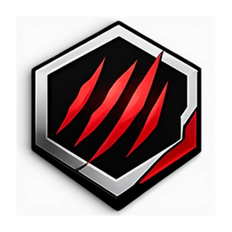

  

<h1 align="center">Mobile Claw Deck (MCD)</h1>

  <b>Windows games on iPhone, with a console-style interface and cloud play.</b> 
  A fork of <a href="https://github.com/thebcd69/bcd-games">BCD</a> by thebcd69, which is a fork of
  <a href="https://github.com/willfaust/Madeira">Madeira</a>. 
  Beta: early software. Many games run, many do not yet.

  <a href="https://github.com/ausfowler/bcd-games/releases"><b>Download the IPA</b></a>
  &nbsp;·&nbsp; <a href="#install">Install</a>
  &nbsp;·&nbsp; <a href="#cloud">Cloud</a>
  &nbsp;·&nbsp; <a href="#credits">Credits</a>

MCD is not the official BCD. It is a separate app (its own app ID, `com.ausfowler.mcd`), so it installs
beside BCD and never replaces it. Everything that runs the games is BCD's: Wine provides Windows, FEX runs
x86 and x64 code on Apple's chips, and DXMT plus BCD's Direct3D 12 runtime draw with Metal. Steam, Epic
Games and GOG sign-in, downloads, BCD Dock and per-game settings all work as they do in BCD.

## What MCD adds

- **Claw Deck's interface:** a big cover carousel on Home that flips each card to Play, Cloud and the
  game's settings; GAMES and DOWNLOADS on LB and RB; a Y menu with everything else. Made for a controller,
  and the Carousel size in the Y menu makes the cards smaller or larger.
- **iPhone Duo support:** the layout follows the folding screen, open or closed, upright or on its side, and
  keeps clear of the closed screen's camera.
- **Cloud (GeForce NOW):** games GeForce NOW has get a Cloud button on their card. Sign in under
  Settings › Cloud with your own NVIDIA account; the stream fits the screen, or the shape you choose
  (16:9, 16:10 or 4:3). See [Cloud](#cloud).
- Holding a direction on the controller scrolls continuously, everywhere.

## What you need

The same as BCD:

- **iPhone or iPad on iOS / iPadOS 18 or later, with an A13 chip or newer.** Games that use geometry
  shaders or tessellation need an A14 or newer; the heaviest games need an A17 Pro or M-series chip and
  plenty of memory.
- **JIT** for Windows games (not for Cloud). iOS lets only an app a debugger starts generate code:
  - iOS 26 or later on A15 / M2 and newer: the built-in helper (paired once on the device), or StikDebug;
  - iOS 18, and iOS 26 on older chips: StikDebug, with its "Always Run Scripts" setting on.
- **A way to install the IPA:** SideStore or AltStore (a free Apple ID works), LiveContainer, or your own
  signing. More memory for big games: GetMoreRam adds Increased Memory Limit to MCD's App ID.
- **Room:** each game needs its full install size on the device.

A free Apple ID keeps only three sideloaded apps active at once. MCD, StikDebug and SideStore or AltStore
can fill all three; **LiveContainer** runs more apps inside one container.

## Install

1. Download the `.ipa` from the latest [release](https://github.com/ausfowler/bcd-games/releases).
2. Install it with SideStore, AltStore or LiveContainer.
3. Open MCD. Setup walks you through JIT, LocalDevVPN, Steam and the extra runtimes.

MCD keeps its own games, sign-ins and settings: nothing is shared with a BCD install.

## Cloud

Cloud streams games from NVIDIA's GeForce NOW with your own account and membership (Free, Performance or
Ultimate). It uses [OpenNOW](https://github.com/OpenCloudGaming/OpenNOW), an open-source GeForce NOW client.
**Neither MCD nor OpenNOW is made or endorsed by NVIDIA**, and NVIDIA could change or block third-party
access at any time. Use it at your own risk and under NVIDIA's terms for your account. During a stream,
View + Menu opens the stream's controls.

## Reporting a problem

Open an issue on [this repository](https://github.com/ausfowler/bcd-games/issues). For a crash, attach the
log from **Settings › Logs**. Please do not report MCD's problems to BCD.

## What is not in the package

MCD's packages carry no Microsoft software. The Visual C++ runtime most games need is downloaded from
Microsoft inside the app, after you accept Microsoft's license terms, and kept unchanged on your device.
Wine Mono comes from WineHQ the same way.

## Building

The build is the workflow [.github/workflows/build-ipa.yml](.github/workflows/build-ipa.yml) and the
scripts it runs under `build/` and `tools/`, step by step. The submodules (Wine, FEX, DXMT, BCD Dock) are
BCD's public repositories, pinned in this repository.

## License

MCD, like BCD, is free software under the GNU General Public License, version 3 ([LICENSE](LICENSE)),
with the Madeira Converter Exception ([LICENSE-EXCEPTION.md](LICENSE-EXCEPTION.md)).
Madeira's own code is under version 3 or (at your option) any later version; BCD's own
files (marked "BCD Material" in their headers) are under version 3 only, so BCD as a whole
can be used under version 3. They also carry additional terms under GPL-3.0 section 7
([LICENSE-BCD.md](LICENSE-BCD.md)): an app that includes them shows *"Includes work from BCD
by thebcd69 (https://github.com/thebcd69/bcd-games)"* on its About, Credits or Licences
screen, keeps their copyright lines, and marks changed files as modified.
Third-party components and their licences: [THIRD-PARTY-NOTICES.md](THIRD-PARTY-NOTICES.md).
There is no warranty.

Steam is a trademark of Valve Corporation. Epic Games and the Epic Games Store are trademarks
of Epic Games, Inc. GOG is a trademark of GOG sp. z o.o. Windows, DirectX, Direct3D and Visual C++ are
trademarks of the Microsoft group of companies. Apple, iPhone, iPad, iOS, iPadOS and Metal
are trademarks of Apple Inc. NVIDIA and GeForce NOW are trademarks of NVIDIA Corporation. MCD is an
independent project, not affiliated with or endorsed by Valve, Epic Games, GOG, Microsoft, Apple, NVIDIA, the
authors of BCD or the authors of Madeira. Game titles named here belong to their
respective owners; MCD is not affiliated with or endorsed by them.

## Credits

**MCD** by ausfowler ([ausfowler](https://github.com/ausfowler)): Claw Deck's interface, iPhone Duo support and Cloud.

**BCD** by **thebcd69** ([thebcd69/bcd-games](https://github.com/thebcd69/bcd-games)), which MCD is a fork of.
Includes work from BCD by thebcd69 (https://github.com/thebcd69/bcd-games).

**OpenNOW** ([OpenCloudGaming/OpenNOW](https://github.com/OpenCloudGaming/OpenNOW)): the open-source GeForce NOW
client behind Cloud.

**Madeira**, which BCD is a fork of:

- **Will Faust** ([willfaust](https://github.com/willfaust)): created Madeira
- **Nick** ([125hz](https://github.com/125hz)): 32-bit game support, the game library and
  Madeira Dock (BCD Dock here)
- **Jfishin** ([Jfishin](https://github.com/Jfishin)): the original native Steam sign-in,
  library and downloads
- **Jesse** ([JesseLovelace](https://github.com/JesseLovelace)): Steam Cloud saves, faster
  game launches, and fixes that let more games run
- **Dan Perks** ([danperks](https://github.com/danperks)): in-app JIT without StikDebug, and
  pairing without a computer
- **spitefulowl** ([spitefulowl](https://github.com/spitefulowl)): Wine and FEX runtime
  fixes, DXMT texture and memory fixes, audio, the swap tier, and library launch options
- **meshoklv** ([meshoklv](https://github.com/meshoklv)): controller fixes, touch taps that
  stay off the mouse, and a crash-guard fix
- **TheHadesc** ([TheHadesc](https://github.com/TheHadesc)): Madeira Dock starts for more
  games, and a touch gamepad that survives the in-game keyboard
- **vancez** ([vancez](https://github.com/vancez)): Steam download checksums, and the idea for
  the download-server fallback in regions without HTTPS servers

**The projects underneath:** [Wine](https://www.winehq.org), [FEX-Emu](https://github.com/FEX-Emu/FEX),
[DXMT](https://github.com/3Shain/dxmt) by Feifan He (3Shain) with the Direct3D 9 frontend by
David Acevedo (dacevedo12), rpmalloc by Mattias Jansson, StikDebug, StikJIT, idevice,
FreeType, and every library listed in THIRD-PARTY-NOTICES.md. Thank you to everyone who
works on them.

**BCD** by thebcd69, with the AltStore and SideStore source by **le0-VV** ([le0-VV](https://github.com/le0-VV)).
